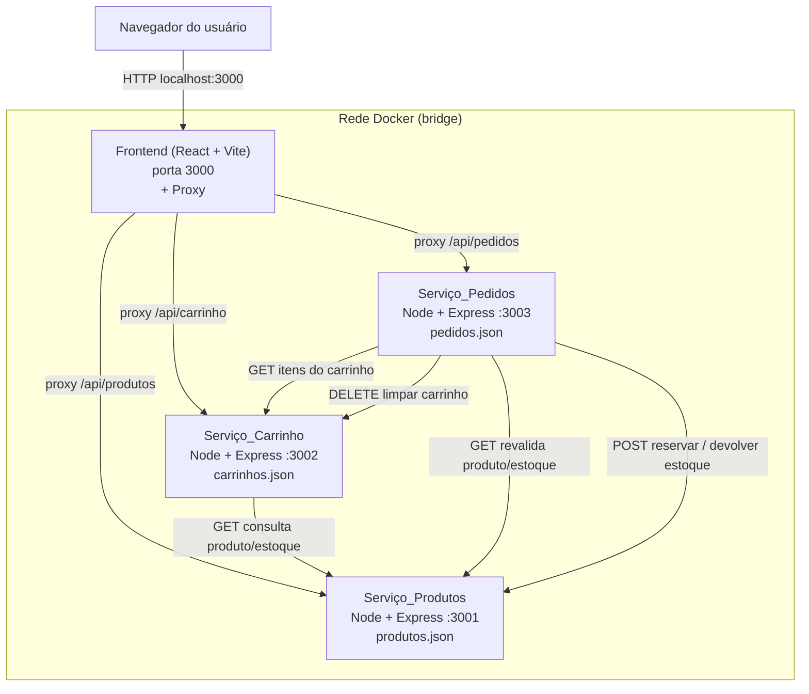
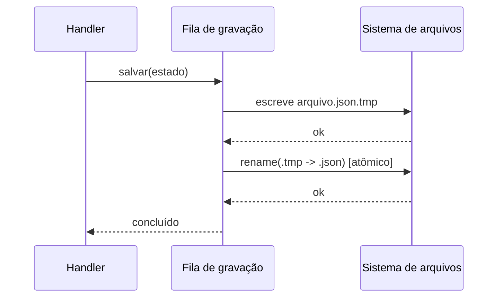

# Documento de Design

## Visão Geral

Este documento descreve o design técnico de uma aplicação de e-commerce construída com arquitetura de microsserviços, cujo objetivo principal é demonstrar, de forma simples e didática, a comunicação entre contêineres Docker independentes. O sistema é composto por quatro serviços conteinerizados — Frontend, Serviço_Produtos, Serviço_Carrinho e Serviço_Pedidos — que se comunicam exclusivamente por APIs REST sobre HTTP com payloads JSON.

O design atende integralmente aos 12 requisitos aprovados, mantendo a complexidade mínima: não há banco de dados tradicional, autenticação, serviços de nuvem ou integrações externas. A persistência é feita em arquivos `.json` por serviço, cada um com acesso exclusivo ao próprio arquivo. Todos os valores monetários são manipulados em **centavos** (inteiros) para evitar erros de arredondamento, sendo formatados em reais apenas na camada de apresentação (Frontend).

O ponto de partida existente (`microsservico-produtos/app.js`, serviço em memória na porta 3000) será reestruturado para o Serviço_Produtos na porta 3001, ganhando persistência, controle de estoque, validação e os demais endpoints descritos aqui.

### Tecnologias

- **Frontend:** React + Vite (porta 3000), proxy de desenvolvimento/produção para os backends.
- **Backends:** Node.js + Express (portas 3001, 3002, 3003).
- **Comunicação:** REST/HTTP/JSON na Rede_Docker, por nome de serviço.
- **Persistência:** arquivos `.json` por serviço, com gravação atômica.
- **Orquestração:** Docker + Docker Compose (`docker compose up --build`).

### Restrições (proibições)

Não serão utilizados: bancos de dados reais (PostgreSQL/MySQL/MongoDB), ORMs (Prisma), caches/filas (Redis/Kafka/RabbitMQ), orquestradores (Kubernetes), autenticação, serviços de nuvem ou integrações externas. Nenhuma funcionalidade além das descritas nos requisitos será adicionada.

## Arquitetura

### Diagrama de Contêineres e Comunicação



### Rede Docker e Resolução por Nome

Todos os serviços participam de uma rede bridge definida no `docker-compose.yml`. Cada serviço é alcançável internamente pelo seu nome de serviço (ex.: `http://produtos:3001`, `http://carrinho:3002`, `http://pedidos:3003`). O navegador nunca conhece esses nomes internos — ele acessa somente `http://localhost:3000` (Frontend). *(Requisitos 10.1, 10.4, 12.1)*

### Proxy do Frontend

O Frontend usa um proxy para encaminhar chamadas do navegador aos backends, evitando CORS e ocultando nomes internos de contêiner: *(Requisito 10.2)*

- **Desenvolvimento:** `server.proxy` do Vite mapeia prefixos (`/api/produtos` → `http://produtos:3001`, `/api/carrinho` → `http://carrinho:3002`, `/api/pedidos` → `http://pedidos:3003`).
- **Produção (build):** servido por um reverse proxy nginx dentro do contêiner do Frontend, com as mesmas regras de encaminhamento.

O navegador sempre chama caminhos relativos (`/api/...`); o proxy resolve o destino real na Rede_Docker.

### Variáveis de Ambiente

Os endereços dos serviços são injetados por variáveis de ambiente no `docker-compose.yml`, evitando URLs fixas no código: *(Requisito 12.5)*

| Serviço | Variável | Valor padrão |
|---|---|---|
| Carrinho | `PRODUTOS_URL` | `http://produtos:3001` |
| Pedidos | `PRODUTOS_URL` | `http://produtos:3001` |
| Pedidos | `CARRINHO_URL` | `http://carrinho:3002` |
| Frontend | `PRODUTOS_URL` / `CARRINHO_URL` / `PEDIDOS_URL` | usados na config do proxy |

### Health Checks e Resiliência à Ordem de Inicialização

Cada backend expõe um endpoint simples `GET /health` que retorna `200 { "status": "ok" }`, usado como `healthcheck` no Compose. *(Requisito 12.7)*

Como a ordem de subida dos contêineres não é garantida, os serviços requisitantes (Carrinho e Pedidos) **não encerram o processo** ao receber erro de comunicação durante a inicialização. Em vez disso: *(Requisitos 10.3, 12.6)*

- Chamadas REST entre serviços usam um cliente HTTP com **retry** (ex.: 3 tentativas, backoff curto) para erros de conexão (`ECONNREFUSED`, timeout).
- Se o serviço dependente permanecer indisponível, a requisição retorna um erro amigável (HTTP 503) com mensagem como `"Serviço de produtos temporariamente indisponível. Tente novamente."` em vez de derrubar o processo.

## Componentes e Interfaces

Convenções gerais:
- Todos os corpos de requisição e resposta são JSON.
- Preços e valores sempre em **centavos** (inteiros não negativos).
- Erros seguem o formato `{ "erro": "mensagem descritiva" }`.
- Códigos de status: `200` OK, `201` Criado, `400` Validação, `404` Não encontrado, `409` Conflito (estoque insuficiente/idempotência), `503` Serviço indisponível.

### Serviço_Produtos (porta 3001)

**Responsabilidades:** cadastro, consulta, edição e exclusão de produtos; controle de estoque (consultar, reservar, devolver); persistência exclusiva em `produtos.json`.

**Endpoints de catálogo:**

| Método | Rota | Descrição | Status |
|---|---|---|---|
| GET | `/produtos` | Lista todos os produtos | 200 |
| POST | `/produtos` | Cria produto | 201 / 400 |
| GET | `/produtos/:id` | Retorna produto por id | 200 / 404 |
| PUT | `/produtos/:id` | Atualiza produto | 200 / 400 / 404 |
| DELETE | `/produtos/:id` | Remove produto | 204 / 404 |

`POST /produtos` — corpo:
```json
{
  "nome": "Notebook",
  "descricao": "14 polegadas",
  "categoria": "Eletrônicos",
  "preco": 350000,
  "estoque": 12,
  "imagemUrl": "https://.../img.png",
  "atributos": { "cor": "prata", "voltagem": "bivolt" }
}
```
Validações *(Requisito 1.9)*: `nome` não vazio; `preco` numérico inteiro ≥ 0; `estoque` inteiro ≥ 0. Em falha, retorna `400 { "erro": ... }`.

**Endpoints internos de estoque** (consumidos por Carrinho e Pedidos): *(Requisito 2)*

| Método | Rota | Descrição | Status |
|---|---|---|---|
| GET | `/produtos/:id/estoque` | Consulta quantidade disponível | 200 / 404 |
| POST | `/produtos/:id/reservar` | Reduz estoque (`{ "quantidade": N }`) | 200 / 409 / 404 |
| POST | `/produtos/:id/devolver` | Aumenta estoque (`{ "quantidade": N }`) | 200 / 404 |

`reservar` só reduz se `estoque >= quantidade`; caso contrário retorna `409 { "erro": "Estoque insuficiente" }` sem alterar o estoque. *(Requisitos 2.2, 2.3)*

### Serviço_Carrinho (porta 3002)

**Responsabilidades:** criar carrinhos, gerenciar itens, calcular subtotal/frete/total, calcular frete por CEP; persistência exclusiva em `carrinhos.json`. Consulta o Serviço_Produtos para validar existência, estoque e obter o preço unitário oficial. *(Requisitos 3, 4, 5)*

| Método | Rota | Descrição | Status |
|---|---|---|---|
| POST | `/carrinho` | Cria carrinho vazio | 201 |
| GET | `/carrinho/:id` | Retorna itens + subtotal/frete/total | 200 / 404 |
| POST | `/carrinho/:id/itens` | Adiciona item (`{ produtoId, quantidade }`) | 201 / 400 / 404 / 409 |
| PUT | `/carrinho/:id/itens/:produtoId` | Altera quantidade (`{ quantidade }`) | 200 / 404 / 409 |
| DELETE | `/carrinho/:id/itens/:produtoId` | Remove um item | 200 / 404 |
| DELETE | `/carrinho/:id/itens` | Limpa todos os itens | 200 / 404 |
| POST | `/carrinho/:id/frete` | Calcula frete por CEP (`{ cep }`) | 200 / 400 / 404 |

Regras principais:
- Ao adicionar/alterar item, consulta `GET /produtos/:id` e `GET /produtos/:id/estoque`; se a quantidade exceder o estoque, recusa com `409 { "erro": "Estoque insuficiente" }`. *(Requisito 3.3)*
- O preço unitário gravado em cada `Item_Carrinho` é **sempre** o obtido do Serviço_Produtos; qualquer preço enviado pelo Frontend é ignorado. *(Requisito 3.4)*
- `GET /carrinho/:id` retorna `subtotal`, `frete` e `total` recalculados; `total = subtotal + frete`, com `frete = 0` quando ainda não calculado. *(Requisitos 5.1, 5.2, 5.3)*

**Cálculo de frete por CEP** *(Requisito 4)*:
1. Normaliza o CEP removendo hífen e espaços; deve conter **exatamente 8 dígitos**, senão `400 { "erro": "CEP inválido" }`. *(Requisitos 4.6, 4.7)*
2. Frete base pelo primeiro dígito: `0–3 → 1500`, `4–6 → 2500`, `7–9 → 3500` centavos. *(Requisitos 4.2, 4.3, 4.4)*
3. Se `subtotal > 50000` centavos, frete grátis (`0`), sobrepondo a regra do CEP. *(Requisito 4.5)*

### Serviço_Pedidos (porta 3003)

**Responsabilidades:** criar pedidos a partir de um carrinho, revalidar e reservar estoque, registrar snapshot imutável, processar pagamento simulado e gerenciar status/histórico; persistência exclusiva em `pedidos.json`. *(Requisitos 6, 7, 8)*

| Método | Rota | Descrição | Status |
|---|---|---|---|
| GET | `/pedidos` | Lista pedidos (id, data, total, status) | 200 |
| GET | `/pedidos/:id` | Retorna pedido completo com snapshot | 200 / 404 |
| POST | `/pedidos` | Cria pedido a partir do carrinho | 201 / 400 / 409 |
| POST | `/pedidos/:id/pagamento` | Pagamento simulado (`{ aprovado: bool }`) | 200 / 404 |

**Fluxo de criação de pedido** (`POST /pedidos` com `{ carrinhoId, comprador: { nome, cep, endereco, numero, complemento? } }`): *(Requisito 6)*
1. Consulta `GET /carrinho/:carrinhoId` no Serviço_Carrinho para obter itens e valores. *(Requisito 6.1)*
2. Revalida cada item junto ao Serviço_Produtos: existência, preço e estoque. *(Requisito 6.2)*
3. Se qualquer item tiver estoque insuficiente, recusa com `409 { "erro": "Estoque insuficiente" }` e **não reserva nada**. *(Requisito 6.6)*
4. Reserva a quantidade de cada produto via `POST /produtos/:id/reservar`. *(Requisito 6.3)*
5. Cria o Pedido com id único, **snapshot imutável** dos itens/valores e status `PENDENTE`. *(Requisitos 6.4, 6.7)*

**Idempotência** *(Requisito 6.5)*: a finalização usa uma **chave de idempotência** derivada do `carrinhoId` (ou um `Idempotency-Key` enviado pelo Frontend). Se já existir um pedido ativo criado a partir do mesmo carrinho que ainda não foi recusado/cancelado, o serviço retorna o pedido existente (`200`) em vez de criar um duplicado e reservar estoque novamente.

**Pagamento simulado** (`POST /pedidos/:id/pagamento` com `{ aprovado }`): *(Requisito 7)*
- `aprovado = true` → status `PAGO`; solicita `DELETE /carrinho/:id/itens` ao Serviço_Carrinho para limpar o carrinho. *(Requisitos 7.1, 7.2)*
- `aprovado = false` → status `PAGAMENTO_RECUSADO`; solicita `POST /produtos/:id/devolver` para cada item, devolvendo o estoque reservado. *(Requisitos 7.3, 7.4)*
- Status restrito a `PENDENTE | PAGO | PAGAMENTO_RECUSADO | CANCELADO`. *(Requisito 7.5)*
- O snapshot nunca é alterado por mudanças posteriores no catálogo. *(Requisito 7.7)*

### Frontend (porta 3000)

**Responsabilidades:** interface React responsiva, consumo dos backends via proxy, formatação monetária em reais, estados de carregamento/sucesso/erro. *(Requisito 11)*

**Telas:**
1. **Catálogo:** cards com imagem, nome, preço, categoria, disponibilidade; ações "ver detalhes" e "adicionar ao carrinho". *(Requisito 11.1)*
2. **Cadastro/edição de produtos:** formulário com nome, descrição, categoria, preço, estoque, imagem e **atributos personalizados dinâmicos** (adicionar par nome/valor, pré-visualização); editar e excluir produtos. *(Requisitos 11.2, 11.3)*
3. **Detalhes do produto:** todas as informações + atributos dinâmicos, seleção de quantidade e adicionar ao carrinho. *(Requisito 11.4)*
4. **Carrinho:** itens, quantidade, preço unitário, subtotal, campo de CEP + calcular frete, frete, total, remover itens, alterar quantidades e finalizar compra. *(Requisito 11.5)*
5. **Checkout:** resumo final + campos nome, CEP, endereço, número, complemento; botões "simular pagamento aprovado/recusado" com mensagem de resultado. *(Requisitos 11.6, 7.6)*
6. **Pedidos:** lista com id, data, produtos, quantidades, total e status; abrir detalhes completos. *(Requisito 11.7)*

**Estado do carrinho:** o `carrinhoId` é armazenado no navegador via `localStorage`; se não existir, o Frontend cria um carrinho (`POST /carrinho`) e guarda o id.

**Estados de UI:** toda operação dependente de backend exibe loading e, ao final, mensagem de sucesso ou erro. Valores monetários (centavos) são formatados como `R$` (ex.: `350000 → R$ 3.500,00`). *(Requisitos 11.8, 11.9, 5.4)*

## Modelos de Dados

### Produto (`produtos.json`)

```json
{
  "id": "p-ab12cd",
  "nome": "Notebook",
  "descricao": "Notebook 14 polegadas",
  "categoria": "Eletrônicos",
  "preco": 350000,
  "estoque": 12,
  "imagemUrl": "https://.../img.png",
  "atributos": { "cor": "prata", "voltagem": "bivolt" }
}
```
`preco` e `estoque` são inteiros ≥ 0. `atributos` é um mapa dinâmico de pares chave-valor. *(Requisitos 1.2, 1.8, 2)*

### Carrinho e Item_Carrinho (`carrinhos.json`)

```json
{
  "id": "c-9f8e7d",
  "itens": [
    { "produtoId": "p-ab12cd", "quantidade": 2, "precoUnitario": 350000 }
  ],
  "cep": "01001000",
  "frete": 0,
  "subtotal": 700000,
  "total": 700000
}
```
`subtotal`, `frete` e `total` podem ser derivados no retorno; `precoUnitario` é copiado do Serviço_Produtos no momento da adição. *(Requisitos 3.4, 5)*

### Pedido (`pedidos.json`)

```json
{
  "id": "o-1a2b3c",
  "carrinhoId": "c-9f8e7d",
  "chaveIdempotencia": "c-9f8e7d",
  "comprador": {
    "nome": "Maria",
    "cep": "01001000",
    "endereco": "Rua A",
    "numero": "100",
    "complemento": "Apto 5"
  },
  "itens": [
    {
      "produtoId": "p-ab12cd",
      "nome": "Notebook",
      "precoUnitario": 350000,
      "quantidade": 2,
      "atributos": { "cor": "prata" }
    }
  ],
  "subtotal": 700000,
  "frete": 0,
  "total": 700000,
  "status": "PENDENTE",
  "data": "2024-01-01T12:00:00.000Z"
}
```
O bloco `itens` é o **Snapshot** imutável, capturado no momento da compra, independente de alterações futuras no catálogo. *(Requisitos 6.4, 6.7, 7.7, 8.2)*

## Utilitário de Persistência Compartilhado

Cada serviço usa um pequeno módulo de persistência (`store.js`), replicado por serviço (sem acesso cruzado a arquivos). Características: *(Requisito 9)*

- **Auto-criação:** na inicialização, se o arquivo não existir, cria com estado inicial (`[]`). *(Requisito 9.1)*
- **Leitura no start:** carrega o conteúdo em memória ao iniciar; em caso de arquivo vazio, assume `[]`.
- **Gravação atômica serializada:** gravações são enfileiradas numa fila sequencial (uma por vez) para evitar escritas concorrentes; cada gravação escreve em um arquivo temporário (`arquivo.json.tmp`) e em seguida faz `rename` atômico sobre o arquivo final. *(Requisito 9.2)*
- **Acesso exclusivo:** o módulo opera apenas sobre o próprio arquivo do serviço; dados de outros serviços são obtidos sempre via REST. *(Requisitos 9.4, 9.5, 10.4)*
- **Persistência entre reinícios:** como os arquivos ficam em volumes bind-mount, os dados sobrevivem a reinícios de contêiner. *(Requisito 9.3)*



## Correctness Properties

*Uma propriedade é uma característica ou comportamento que deve ser verdadeiro em todas as execuções válidas de um sistema — essencialmente, uma afirmação formal sobre o que o sistema deve fazer. As propriedades servem de ponte entre especificações legíveis por humanos e garantias de correção verificáveis por máquina.*

As propriedades a seguir são derivadas das acceptance criteria amenáveis a teste baseado em propriedades (PBT). A lógica monetária, de estoque, de frete e de serialização é pura e determinística, com grande espaço de entradas — ideal para PBT. Operações de CRUD, UI, proxy e orquestração são cobertas por testes de exemplo/integração/smoke (ver Estratégia de Testes).

### Propriedade 1: Preço sempre em centavos (inteiro não negativo)

*Para qualquer* produto criado ou editado com dados válidos, o campo `preco` armazenado é sempre um inteiro maior ou igual a zero.

**Validates: Requirements 1.2, 1.9**

### Propriedade 2: Subtotal e total consistentes

*Para qualquer* carrinho, o `subtotal` é igual à soma de `precoUnitario * quantidade` de todos os itens, e o `total` é igual a `subtotal + frete`, considerando `frete = 0` quando não calculado.

**Validates: Requirements 5.1, 5.2, 5.3**

### Propriedade 3: Estoque nunca negativo e reserva limitada ao disponível

*Para qualquer* produto e qualquer quantidade solicitada de reserva, se a quantidade exceder o estoque disponível a reserva é recusada e o estoque permanece inalterado; caso contrário o estoque é reduzido exatamente pela quantidade reservada e nunca fica negativo.

**Validates: Requirements 2.2, 2.3**

### Propriedade 4: Round-trip de reserva e devolução preserva o estoque

*Para qualquer* produto e qualquer quantidade reservável, reservar essa quantidade e em seguida devolvê-la resulta em um estoque igual ao estoque original.

**Validates: Requirements 2.2, 2.4**

### Propriedade 5: Cálculo de frete determinístico por CEP e subtotal

*Para qualquer* CEP válido (8 dígitos) e qualquer subtotal, o frete calculado é: `0` centavos se o subtotal for maior que `50000`; caso contrário `1500` para primeiro dígito 0–3, `2500` para 4–6 e `3500` para 7–9 centavos; a presença ou ausência de hífen no CEP não altera o resultado.

**Validates: Requirements 4.1, 4.2, 4.3, 4.4, 4.5, 4.6**

### Propriedade 6: Validação de CEP exige exatamente 8 dígitos

*Para qualquer* string de CEP que, após remover hífen e espaços, não contenha exatamente 8 dígitos, o cálculo de frete é recusado com erro de validação.

**Validates: Requirements 4.6, 4.7**

### Propriedade 7: Preço unitário sempre obtido do catálogo

*Para qualquer* adição de item ao carrinho, o `precoUnitario` gravado é igual ao preço do produto no Serviço_Produtos, independentemente de qualquer preço enviado no corpo da requisição.

**Validates: Requirements 3.4**

### Propriedade 8: Snapshot do pedido imutável

*Para qualquer* pedido criado, alterações posteriores de preço ou atributos dos produtos no catálogo não modificam o snapshot de itens e valores registrado no pedido.

**Validates: Requirements 6.4, 6.7, 7.7**

### Propriedade 9: Idempotência da finalização de compra

*Para qualquer* sequência de tentativas de finalização com a mesma chave de idempotência (mesmo carrinho), apenas um pedido é criado e todas as tentativas retornam o mesmo pedido, sem reservar estoque mais de uma vez.

**Validates: Requirements 6.5**

### Propriedade 10: Gravação atômica preserva JSON íntegro

*Para qualquer* sequência de operações de gravação em um serviço, o arquivo de persistência, quando lido em qualquer momento após uma gravação concluída, é sempre um JSON válido e parseável, refletindo um estado consistente.

**Validates: Requirements 9.2**

## Tratamento de Erros

Todas as respostas de erro usam o formato `{ "erro": "mensagem descritiva" }` e códigos HTTP adequados.

| Situação | Código | Mensagem (exemplo) | Requisitos |
|---|---|---|---|
| Validação de produto (nome/preço/estoque) | 400 | "Nome é obrigatório" / "Preço inválido" / "Estoque não pode ser negativo" | 1.9 |
| Produto/carrinho/pedido inexistente | 404 | "Produto não encontrado" | 1.5, 3.9, 8.3 |
| CEP inválido | 400 | "CEP inválido: informe 8 dígitos" | 4.7 |
| Estoque insuficiente (carrinho) | 409 | "Estoque insuficiente" | 3.3 |
| Estoque insuficiente (reserva/pedido) | 409 | "Estoque insuficiente" | 2.3, 6.6 |
| Pedido duplicado (idempotência) | 200 | retorna o pedido existente | 6.5 |
| Serviço de backend indisponível | 503 | "Serviço X temporariamente indisponível. Tente novamente." | 10.3 |

**Indisponibilidade e retries:** o cliente HTTP entre serviços aplica retry (ex.: 3 tentativas com backoff curto) para erros de conexão. Esgotadas as tentativas, retorna `503` amigável sem derrubar o processo, o que também cobre a resiliência à ordem de inicialização. *(Requisitos 10.3, 12.6)*

**Atomicidade:** falhas durante a gravação não corrompem o arquivo, pois o `rename` só substitui o arquivo final após a escrita completa do temporário. *(Requisito 9.2)*

**Prevenção de pedido duplicado:** a chave de idempotência garante que repetir a finalização não cria pedidos adicionais nem reserva estoque repetidamente. *(Requisito 6.5)*

## Estratégia de Testes

Abordagem dupla: testes de exemplo/unitários para casos concretos, bordas e integração; e testes baseados em propriedades (PBT) para a lógica pura e universal.

### Testes Baseados em Propriedades (PBT)

- Biblioteca: **fast-check** (ecossistema Node/JS), integrada ao runner de testes (ex.: Vitest/Jest). Não implementar PBT do zero.
- Cada propriedade da seção Correctness Properties é implementada por **um único** teste de propriedade.
- Mínimo de **100 iterações** por teste (configuração `numRuns: 100`).
- Cada teste referencia a propriedade de design via comentário de tag:
  `// Feature: ecommerce-microservices, Property N: <texto da propriedade>`
- Alvos: cálculo de frete/validação de CEP (Prop. 5, 6), subtotal/total (Prop. 2), estoque reservar/devolver (Prop. 3, 4), preço em centavos (Prop. 1), preço unitário do catálogo (Prop. 7), snapshot imutável (Prop. 8), idempotência (Prop. 9), gravação atômica (Prop. 10). Para propriedades que envolvem chamadas entre serviços (7, 8, 9), usa-se mocks do cliente HTTP para testar a lógica isoladamente.

### Testes de Exemplo e Unitários

- CRUD de produtos (criar/listar/obter/editar/excluir e 404). *(Requisito 1)*
- Gestão de itens do carrinho (adicionar/alterar/remover/limpar e 404). *(Requisito 3)*
- Pagamento simulado: aprovado → PAGO + carrinho limpo; recusado → PAGAMENTO_RECUSADO + estoque devolvido. *(Requisito 7)*
- Consulta de pedidos (lista/detalhe/404). *(Requisito 8)*
- Frontend: testes de componente para as telas e estados de loading/sucesso/erro; formatação monetária em reais. *(Requisito 11)*

### Testes de Integração e Smoke

- **Comunicação entre serviços:** carrinho consultando produtos; pedidos revalidando/reservando/devolvendo; chamada via proxy do Frontend. *(Requisitos 10.1, 10.2, 10.4)*
- **Indisponibilidade:** serviço dependente desligado → requisitante retorna `503` amigável; retry durante inicialização. *(Requisitos 10.3, 12.6)*
- **Persistência:** arquivo criado se ausente; dados sobrevivem a reinício de contêiner. *(Requisitos 9.1, 9.3)*
- **Health checks:** `GET /health` de cada backend retorna `200`. *(Requisito 12.7)*
- **Orquestração:** `docker compose up --build` sobe os quatro serviços; Frontend disponível em `http://localhost:3000`. *(Requisito 12.3)*

### Fluxo Manual de Integração (documentado no README)

Sequência ponta a ponta a ser documentada no README, com exemplos de `curl`:

1. Subir tudo: `docker compose up --build`.
2. Health: `curl http://localhost:3001/health` (e 3002, 3003).
3. Criar produto:
   ```bash
   curl -X POST http://localhost:3001/produtos \
     -H "Content-Type: application/json" \
     -d '{"nome":"Notebook","descricao":"14pol","categoria":"Eletrônicos","preco":350000,"estoque":12,"atributos":{"cor":"prata"}}'
   ```
4. Listar produtos: `curl http://localhost:3001/produtos`.
5. Criar carrinho: `curl -X POST http://localhost:3002/carrinho`.
6. Adicionar item:
   ```bash
   curl -X POST http://localhost:3002/carrinho/<ID>/itens \
     -H "Content-Type: application/json" -d '{"produtoId":"<PID>","quantidade":1}'
   ```
7. Calcular frete:
   ```bash
   curl -X POST http://localhost:3002/carrinho/<ID>/frete \
     -H "Content-Type: application/json" -d '{"cep":"01001-000"}'
   ```
8. Consultar carrinho (subtotal/frete/total): `curl http://localhost:3002/carrinho/<ID>`.
9. Finalizar pedido:
   ```bash
   curl -X POST http://localhost:3003/pedidos \
     -H "Content-Type: application/json" \
     -d '{"carrinhoId":"<ID>","comprador":{"nome":"Maria","cep":"01001000","endereco":"Rua A","numero":"100"}}'
   ```
10. Pagar (aprovado):
    ```bash
    curl -X POST http://localhost:3003/pedidos/<OID>/pagamento \
      -H "Content-Type: application/json" -d '{"aprovado":true}'
    ```
11. Consultar pedidos: `curl http://localhost:3003/pedidos` e `curl http://localhost:3003/pedidos/<OID>`.
12. Validar via Frontend em `http://localhost:3000` (catálogo → carrinho → checkout → pedidos).

O README também documentará o fluxo de teste de indisponibilidade (parar um serviço e observar o erro amigável) e o teste de reinício (reiniciar um contêiner e confirmar persistência).
