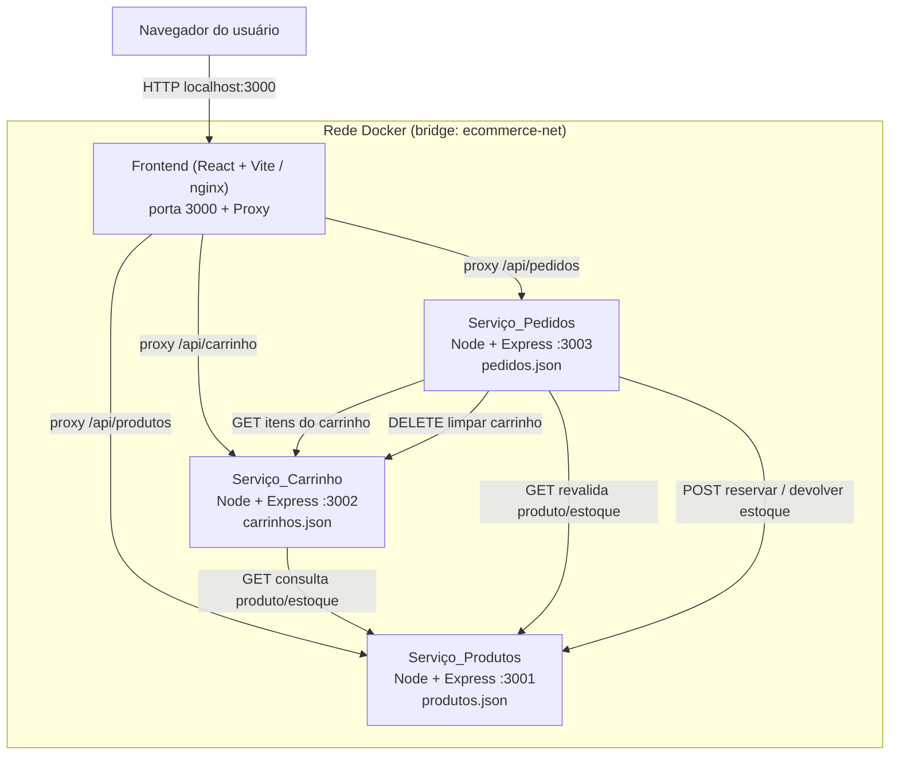

# E-commerce com Arquitetura de Microsserviços

Aplicação de e-commerce simples, construída para demonstrar, de forma didática, a **comunicação entre contêineres Docker independentes** por meio de APIs REST. O sistema é composto por **quatro contêineres** que conversam exclusivamente via HTTP/JSON na rede interna do Docker:

| Contêiner | Tecnologia | Porta | Responsabilidade |
|---|---|---|---|
| **Frontend** | React + Vite (servido por nginx no build) | `3000` | Interface do usuário + proxy `/api/...` para os backends |
| **Serviço_Produtos** | Node.js + Express | `3001` | Catálogo e controle de estoque |
| **Serviço_Carrinho** | Node.js + Express | `3002` | Carrinho, subtotal/total e cálculo de frete |
| **Serviço_Pedidos** | Node.js + Express | `3003` | Pedidos, pagamento simulado e histórico |

Características do projeto:

- **Objetivo didático:** evidenciar a comunicação entre contêineres via REST, com cada serviço em um processo/contêiner próprio.
- **Sem banco de dados tradicional:** cada serviço persiste em um arquivo `.json` próprio (gravação atômica).
- **Sem autenticação, nuvem ou integrações externas.**
- **Valores monetários em centavos** (inteiros) em todo o backend; a formatação em reais acontece apenas no Frontend (ex.: `350000 → R$ 3.500,00`).
- **Orquestração** com um único comando via Docker Compose.

---

## Arquitetura

### Os quatro serviços

- **Frontend (3000)** — SPA React que exibe catálogo, detalhes, cadastro/edição de produtos, carrinho, checkout e histórico de pedidos. O navegador chama **sempre caminhos relativos** `/api/...`; nunca conhece os nomes internos dos contêineres.
- **Serviço_Produtos (3001)** — cadastro/consulta/edição/exclusão de produtos e controle de estoque (consultar, reservar, devolver). Persiste em `produtos.json`.
- **Serviço_Carrinho (3002)** — cria carrinhos, gerencia itens, calcula subtotal/frete/total e calcula frete por CEP. Consulta o Serviço_Produtos para validar existência/estoque e obter o **preço unitário oficial**. Persiste em `carrinhos.json`.
- **Serviço_Pedidos (3003)** — cria pedidos a partir de um carrinho, revalida e reserva estoque, grava um **snapshot imutável** dos itens, processa pagamento simulado e gerencia status/histórico. Persiste em `pedidos.json`.

### Rede Docker e comunicação por nome de serviço

Todos os contêineres participam de uma rede bridge (`ecommerce-net`). Cada serviço é alcançável internamente pelo **nome de serviço** definido no `docker-compose.yml`:

- `http://produtos:3001`
- `http://carrinho:3002`
- `http://pedidos:3003`

As portas também são publicadas no host (`localhost:3001/3002/3003`) para inspeção individual e para os testes com `curl`.

### Proxy do Frontend

O Frontend encaminha chamadas do navegador aos backends, evitando CORS e ocultando os nomes internos de contêiner:

- **Desenvolvimento:** `server.proxy` do Vite.
- **Produção (build):** reverse proxy **nginx** dentro do contêiner do Frontend.

Regras de encaminhamento (reescrevem `/api/<servico>` para o prefixo real do backend):

```
/api/produtos  -> produtos:3001  /produtos
/api/carrinho  -> carrinho:3002  /carrinho
/api/pedidos   -> pedidos:3003   /pedidos
```

### Diagrama



---

## Pré-requisitos

- **Docker** (Engine 20.10+).
- **Docker Compose** (plugin `docker compose` v2+).

Não é necessário instalar Node.js para executar a aplicação via Docker — tudo roda dentro dos contêineres. Node.js só é necessário se você quiser rodar os testes automatizados localmente (ver [Testes automatizados](#testes-automatizados)).

---

## Como executar

A partir da raiz do projeto, execute:

```bash
docker compose up --build
```

Isso constrói e inicia os quatro contêineres. Em seguida, acesse a aplicação no navegador:

```
http://localhost:3000
```

As APIs ficam disponíveis diretamente no host para inspeção/testes:

- Produtos: `http://localhost:3001`
- Carrinho: `http://localhost:3002`
- Pedidos: `http://localhost:3003`

Cada serviço aparece como um **contêiner individual** no Docker Desktop (ou em `docker compose ps`), o que facilita visualizar a arquitetura de microsserviços.

Para parar e remover os contêineres:

```bash
docker compose down
```

Para parar sem remover (preservando os contêineres):

```bash
docker compose stop
```

---

## Estrutura do projeto

```
.
├── docker-compose.yml          # Orquestra os quatro serviços (rede, volumes, env, healthcheck)
├── servico-produtos/           # Serviço_Produtos (porta 3001)
│   ├── Dockerfile
│   ├── server.js               # Rotas Express do catálogo e estoque
│   ├── produto.js              # Modelo e validação de Produto
│   ├── store.js                # Persistência atômica (produtos.json)
│   └── data/
│       └── produtos.json       # Dados persistidos (bind-mount)
├── servico-carrinho/           # Serviço_Carrinho (porta 3002)
│   ├── Dockerfile
│   ├── server.js
│   ├── carrinho.js             # Modelo + cálculo de subtotal/total
│   ├── frete.js                # Validação de CEP + cálculo de frete
│   ├── produtosClient.js       # Cliente REST para o Serviço_Produtos
│   ├── store.js
│   └── data/
│       └── carrinhos.json      # Dados persistidos (bind-mount)
├── servico-pedidos/            # Serviço_Pedidos (porta 3003)
│   ├── Dockerfile
│   ├── server.js
│   ├── pedido.js               # Modelo de Pedido + status
│   ├── carrinhoClient.js       # Cliente REST para o Serviço_Carrinho
│   ├── produtosClient.js       # Cliente REST para o Serviço_Produtos
│   ├── store.js
│   └── data/
│       └── pedidos.json        # Dados persistidos (bind-mount)
└── frontend/                   # Frontend React + Vite (porta 3000)
    ├── Dockerfile
    ├── nginx.conf              # Reverse proxy /api/... no build de produção
    ├── vite.config.js          # Proxy de desenvolvimento + config de testes
    └── src/                     # Páginas, componentes e serviços de API
```

> Os arquivos em cada `data/` são montados como volumes **bind-mount** no `docker-compose.yml`, de modo que os dados sobrevivem a reinícios de contêiner.

---

## Documentação das APIs

Convenções gerais:

- Corpos de requisição e resposta sempre em **JSON**.
- Preços e valores sempre em **centavos** (inteiros não negativos). Ex.: `350000` = R$ 3.500,00.
- Erros seguem o formato `{ "erro": "mensagem descritiva" }`.
- Códigos de status: `200` OK · `201` Criado · `204` Sem conteúdo · `400` Validação · `404` Não encontrado · `409` Conflito (estoque/idempotência) · `503` Serviço dependente indisponível.

### Serviço_Produtos (porta 3001)

| Método | Rota | Descrição | Status |
|---|---|---|---|
| `GET` | `/produtos` | Lista todos os produtos | `200` |
| `POST` | `/produtos` | Cria um produto com id único | `201` / `400` |
| `GET` | `/produtos/:id` | Retorna um produto por id | `200` / `404` |
| `PUT` | `/produtos/:id` | Atualiza um produto existente | `200` / `400` / `404` |
| `DELETE` | `/produtos/:id` | Remove um produto | `204` / `404` |
| `GET` | `/produtos/:id/estoque` | Consulta a quantidade disponível (interno) | `200` / `404` |
| `POST` | `/produtos/:id/reservar` | Reduz o estoque se disponível (interno) | `200` / `400` / `404` / `409` |
| `POST` | `/produtos/:id/devolver` | Aumenta o estoque reservado (interno) | `200` / `400` / `404` |
| `GET` | `/health` | Verificação de saúde | `200` |

Corpo de `POST /produtos` (e `PUT /produtos/:id`):

```json
{
  "nome": "Notebook",
  "descricao": "Notebook 14 polegadas",
  "categoria": "Eletrônicos",
  "preco": 350000,
  "estoque": 12,
  "imagemUrl": "https://exemplo.com/img.png",
  "atributos": { "cor": "prata", "voltagem": "bivolt" }
}
```

Validações: `nome` não vazio; `preco` inteiro ≥ 0 (em centavos); `estoque` inteiro ≥ 0. Em falha, retorna `400 { "erro": "..." }`. Os endpoints de estoque recebem `{ "quantidade": N }` (inteiro ≥ 1); `reservar` só reduz quando `estoque >= quantidade`, senão retorna `409 { "erro": "Estoque insuficiente" }` sem alterar o estoque.

### Serviço_Carrinho (porta 3002)

| Método | Rota | Descrição | Status |
|---|---|---|---|
| `POST` | `/carrinho` | Cria um carrinho vazio | `201` |
| `GET` | `/carrinho/:id` | Retorna itens + subtotal/frete/total recalculados | `200` / `404` |
| `POST` | `/carrinho/:id/itens` | Adiciona item (`{ produtoId, quantidade }`) | `201` / `400` / `404` / `409` |
| `PUT` | `/carrinho/:id/itens/:produtoId` | Altera a quantidade (`{ quantidade }`) | `200` / `400` / `404` / `409` |
| `DELETE` | `/carrinho/:id/itens/:produtoId` | Remove um item | `200` / `404` |
| `DELETE` | `/carrinho/:id/itens` | Limpa todos os itens | `200` / `404` |
| `POST` | `/carrinho/:id/frete` | Calcula o frete por CEP (`{ cep }`) | `200` / `400` / `404` |
| `GET` | `/health` | Verificação de saúde | `200` |

Observações:

- Ao adicionar/alterar item, o serviço consulta o Serviço_Produtos (`GET /produtos/:id` e `GET /produtos/:id/estoque`); se a quantidade exceder o estoque, recusa com `409`.
- O `precoUnitario` gravado em cada item é **sempre** o preço oficial do catálogo; qualquer preço enviado no corpo é ignorado.
- `GET /carrinho/:id` retorna `subtotal`, `frete` e `total`, com `total = subtotal + frete` (frete `0` quando ainda não calculado).

**Regras de frete por CEP:**

1. O CEP é normalizado (remove hífen/espaços) e deve conter **exatamente 8 dígitos**, senão retorna `400 { "erro": "CEP inválido" }`. Aceita com ou sem hífen (`01001-000` ou `01001000`).
2. Frete base pelo **primeiro dígito** do CEP:
   - `0–3` → **R$ 15,00** (`1500` centavos)
   - `4–6` → **R$ 25,00** (`2500` centavos)
   - `7–9` → **R$ 35,00** (`3500` centavos)
3. Se o `subtotal > R$ 500,00` (`50000` centavos), o **frete é grátis** (`0`), sobrepondo a regra do CEP.

### Serviço_Pedidos (porta 3003)

| Método | Rota | Descrição | Status |
|---|---|---|---|
| `GET` | `/pedidos` | Lista pedidos (id, data, total, status) | `200` |
| `GET` | `/pedidos/:id` | Retorna o pedido completo com snapshot | `200` / `404` |
| `POST` | `/pedidos` | Cria um pedido a partir de um carrinho | `201` / `400` / `404` / `409` / `503` |
| `POST` | `/pedidos/:id/pagamento` | Pagamento simulado (`{ aprovado }`) | `200` / `400` / `404` / `409` |
| `GET` | `/health` | Verificação de saúde | `200` |

Corpo de `POST /pedidos`:

```json
{
  "carrinhoId": "c-9f8e7d",
  "comprador": {
    "nome": "Maria",
    "cep": "01001000",
    "endereco": "Rua A",
    "numero": "100",
    "complemento": "Apto 5"
  }
}
```

`nome`, `cep`, `endereco` e `numero` são obrigatórios; `complemento` é opcional. O serviço consulta o carrinho, revalida cada item no catálogo, reserva o estoque e cria o pedido com snapshot imutável e status `PENDENTE`. A finalização é **idempotente**: repetir com o mesmo carrinho (ou enviando o cabeçalho `Idempotency-Key`) retorna o pedido já existente (`200`) em vez de duplicar.

Corpo de `POST /pedidos/:id/pagamento`:

```json
{ "aprovado": true }
```

- `aprovado: true` → status `PAGO` e solicita a limpeza do carrinho associado.
- `aprovado: false` → status `PAGAMENTO_RECUSADO` e devolve o estoque reservado de cada item.
- Status possíveis: `PENDENTE` · `PAGO` · `PAGAMENTO_RECUSADO` · `CANCELADO`.

### Modelos de dados

**Produto** (`produtos.json`):

```json
{
  "id": "p-ab12cd",
  "nome": "Notebook",
  "descricao": "Notebook 14 polegadas",
  "categoria": "Eletrônicos",
  "preco": 350000,
  "estoque": 12,
  "imagemUrl": "https://exemplo.com/img.png",
  "atributos": { "cor": "prata", "voltagem": "bivolt" }
}
```

**Carrinho** (`carrinhos.json`):

```json
{
  "id": "c-9f8e7d",
  "itens": [
    { "produtoId": "p-ab12cd", "quantidade": 2, "precoUnitario": 350000 }
  ],
  "cep": "01001000",
  "frete": 0,
  "subtotal": 700000,
  "total": 700000
}
```

**Pedido** (`pedidos.json`) — o bloco `itens` é o **snapshot imutável** capturado no momento da compra:

```json
{
  "id": "o-1a2b3c",
  "carrinhoId": "c-9f8e7d",
  "chaveIdempotencia": "c-9f8e7d",
  "comprador": {
    "nome": "Maria",
    "cep": "01001000",
    "endereco": "Rua A",
    "numero": "100",
    "complemento": "Apto 5"
  },
  "itens": [
    {
      "produtoId": "p-ab12cd",
      "nome": "Notebook",
      "precoUnitario": 350000,
      "quantidade": 2,
      "atributos": { "cor": "prata" }
    }
  ],
  "subtotal": 700000,
  "frete": 0,
  "total": 700000,
  "status": "PENDENTE",
  "data": "2024-01-01T12:00:00.000Z"
}
```

---

## Fluxo de teste ponta a ponta (curl)

Os exemplos abaixo usam as portas publicadas no host (`localhost:3001/3002/3003`). O fluxo cobre: **produto → carrinho → frete → pedido → pagamento → consulta**.

> Os identificadores (`<PRODUTO_ID>`, `<CARRINHO_ID>`, `<PEDIDO_ID>`) aparecem nas respostas JSON (campo `id`). Copie o valor retornado em cada passo e substitua-o no comando seguinte.

**1. Verificar a saúde dos serviços:**

```bash
curl http://localhost:3001/health
curl http://localhost:3002/health
curl http://localhost:3003/health
```

**2. Criar um produto** (anote o `id` retornado como `<PRODUTO_ID>`):

```bash
curl -X POST http://localhost:3001/produtos \
  -H "Content-Type: application/json" \
  -d '{"nome":"Notebook","descricao":"14 polegadas","categoria":"Eletrônicos","preco":350000,"estoque":12,"imagemUrl":"https://exemplo.com/img.png","atributos":{"cor":"prata"}}'
```

**3. Listar os produtos:**

```bash
curl http://localhost:3001/produtos
```

**4. Criar um carrinho** (anote o `id` como `<CARRINHO_ID>`):

```bash
curl -X POST http://localhost:3002/carrinho
```

**5. Adicionar um item ao carrinho:**

```bash
curl -X POST http://localhost:3002/carrinho/<CARRINHO_ID>/itens \
  -H "Content-Type: application/json" \
  -d '{"produtoId":"<PRODUTO_ID>","quantidade":1}'
```

**6. Calcular o frete por CEP:**

```bash
curl -X POST http://localhost:3002/carrinho/<CARRINHO_ID>/frete \
  -H "Content-Type: application/json" \
  -d '{"cep":"01001-000"}'
```

**7. Consultar o carrinho** (veja `subtotal`, `frete` e `total`):

```bash
curl http://localhost:3002/carrinho/<CARRINHO_ID>
```

**8. Finalizar o pedido** (anote o `id` como `<PEDIDO_ID>`):

```bash
curl -X POST http://localhost:3003/pedidos \
  -H "Content-Type: application/json" \
  -d '{"carrinhoId":"<CARRINHO_ID>","comprador":{"nome":"Maria","cep":"01001000","endereco":"Rua A","numero":"100"}}'
```

**9. Simular o pagamento (aprovado):**

```bash
curl -X POST http://localhost:3003/pedidos/<PEDIDO_ID>/pagamento \
  -H "Content-Type: application/json" \
  -d '{"aprovado":true}'
```

**10. Consultar os pedidos e o detalhe:**

```bash
curl http://localhost:3003/pedidos
curl http://localhost:3003/pedidos/<PEDIDO_ID>
```

Também é possível validar todo o fluxo pela interface em `http://localhost:3000` (catálogo → carrinho → checkout → pedidos).

---

## Teste de indisponibilidade entre serviços

Demonstra que um serviço requisitante trata a indisponibilidade de um dependente com um **erro amigável (HTTP 503)** em vez de derrubar o processo.

1. Com tudo no ar, pare o Serviço_Produtos:

   ```bash
   docker compose stop produtos
   ```

2. Tente adicionar um item ao carrinho (que depende do catálogo):

   ```bash
   curl -i -X POST http://localhost:3002/carrinho/<CARRINHO_ID>/itens \
     -H "Content-Type: application/json" \
     -d '{"produtoId":"<PRODUTO_ID>","quantidade":1}'
   ```

   A resposta deve ser `503` com uma mensagem amigável, por exemplo:

   ```json
   { "erro": "Serviço de produtos temporariamente indisponível. Tente novamente." }
   ```

   O mesmo vale ao tentar finalizar um pedido (`POST /pedidos`) com o catálogo parado.

3. Reinicie o serviço para recuperar:

   ```bash
   docker compose start produtos
   ```

   Após o contêiner ficar saudável, as mesmas requisições voltam a funcionar normalmente.

---

## Teste de reinício e persistência

Demonstra que os dados sobrevivem a reinícios de contêiner, graças aos volumes **bind-mount** apontando para cada `data/`.

1. Crie um produto (ver passo 2 do fluxo ponta a ponta) e confira o arquivo `servico-produtos/data/produtos.json` no projeto — o produto estará lá.

2. Reinicie o contêiner do catálogo:

   ```bash
   docker compose restart produtos
   ```

   (ou derrube e suba tudo novamente com `docker compose down` seguido de `docker compose up`).

3. Após o reinício, confirme que o produto continua disponível:

   ```bash
   curl http://localhost:3001/produtos
   ```

   O produto criado antes do reinício deve continuar na lista, pois os dados estão persistidos em `servico-produtos/data/produtos.json` via bind-mount. O mesmo comportamento se aplica a `servico-carrinho/data/carrinhos.json` e `servico-pedidos/data/pedidos.json`.

---

## Testes automatizados

Cada backend possui testes com **Vitest**, incluindo testes baseados em propriedades com **fast-check**. O Frontend possui testes de componente com Vitest + Testing Library.

Para rodar localmente (requer Node.js instalado), em cada pasta:

```bash
# Backends
cd servico-produtos && npm install && npm test
cd servico-carrinho && npm install && npm test
cd servico-pedidos  && npm install && npm test

# Frontend
cd frontend && npm install && npm test
```

Cada serviço expõe os scripts `npm test` (execução única) e `npm run test:watch` (modo observação).

---

## Notas

- **Sem banco de dados, autenticação ou serviços externos.** Toda a persistência é em arquivos `.json`, com gravação atômica (arquivo temporário + `rename`) e acesso exclusivo de cada serviço ao próprio arquivo.
- **Comunicação exclusivamente via REST** na rede Docker: um serviço nunca lê o arquivo de dados de outro — sempre consulta a API correspondente.
- **Valores monetários em centavos** no backend; a formatação em reais acontece apenas na camada de apresentação (Frontend).
- **Resiliência à ordem de inicialização:** os serviços requisitantes aplicam retry/backoff e retornam `503` amigável sem encerrar o processo quando um dependente ainda não respondeu.
